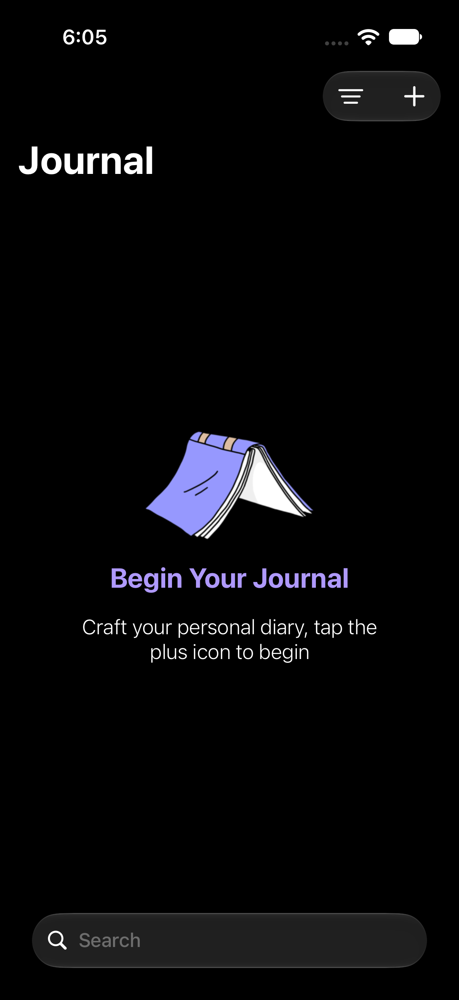
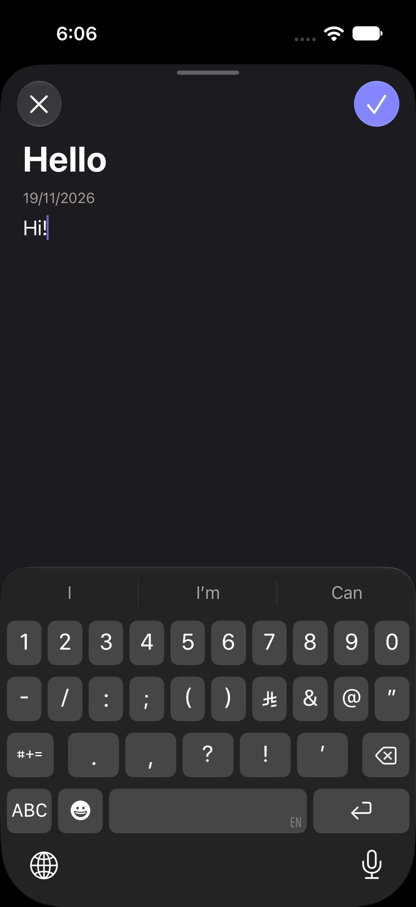
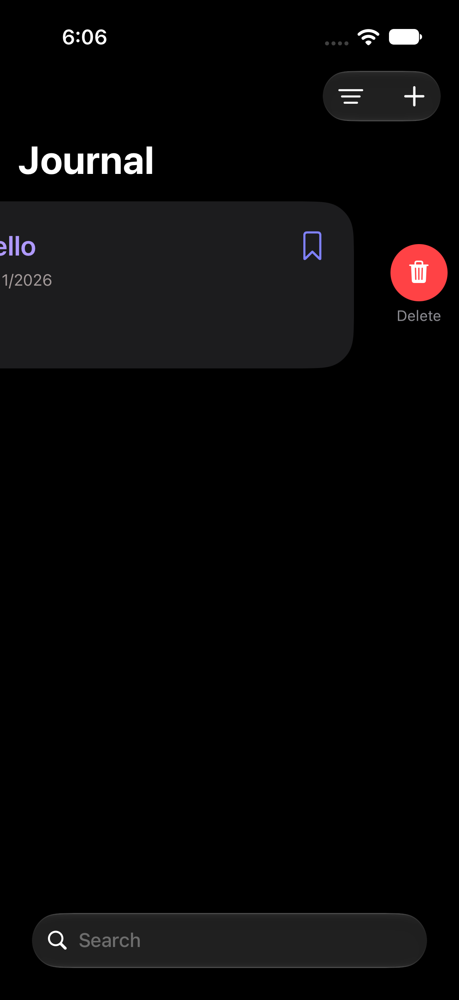
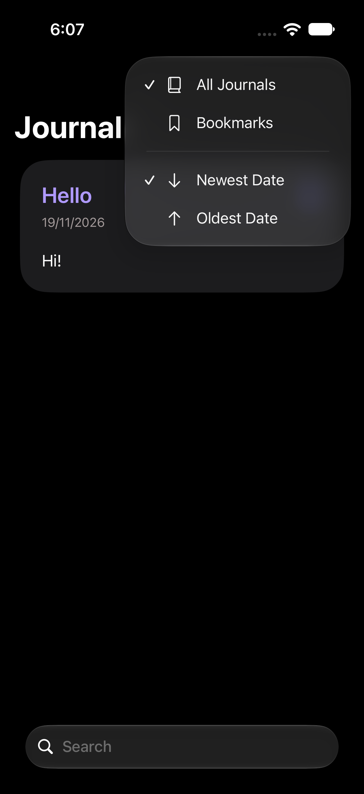

# Journali

Journali is a simple iOS journaling app. Users can write their thoughts, edit them, bookmark their favorites, and find them again with search.

## Main Features
- Splash screen that leads to the main page
- Empty state for users with no journals
- Add a new journal
- Edit a journal by tapping its card
- Bookmark a journal
- Swipe to delete a journal, with a confirmation alert
- Search journals by title, text, or date
- Filter journals by bookmarks and sort them by newest or oldest date

## Technologies Used
- Swift
- SwiftUI
- MVVM architecture

  
  
  
  

